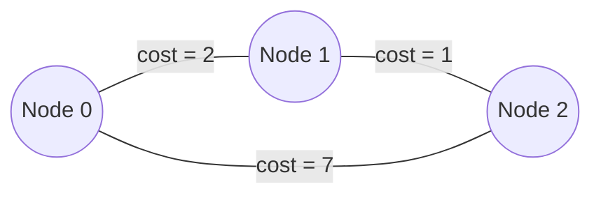

# Experiment 10: Distance Vector Routing Algorithm

---

## 1. Aim
To simulate the **Distance Vector Routing Algorithm** using the distributed Bellman-Ford algorithm in C to compute optimal least-cost routing tables for all network nodes.

---

## 2. Objective
- To understand dynamic routing principles at the Network Layer (Layer 3).
- To implement the decentralized Bellman-Ford shortest-path algorithm in C.
- To analyze how neighboring nodes iteratively exchange distance vectors to converge on global optimal routes.
- To generate and interpret the final routing table (Destination, Next Hop, Minimum Distance) for every router in the network topology.

---

## 3. Theoretical Background

### Network Routing & Distance Vector Protocols
Routing is the process of selecting paths across a network to deliver packets from source hosts to destination hosts.
- **Link-State Routing (e.g. OSPF):** Every node possesses global network topology information (using Dijkstra’s algorithm).
- **Distance Vector Routing (e.g. RIP - Routing Information Protocol):** Decentralized, iterative, and asynchronous. Each node only knows the cost to directly connected physical neighbors and exchanges its current distance estimate vector with those neighbors.

### The Bellman-Ford Equation
Let $D_x(y)$ be the cost of the least-cost path from node $x$ to node $y$. The Bellman-Ford relation states:
$$D_x(y) = \min_v \left\{ c(x, v) + D_v(y) \right\}$$
where:
- $\min_v$ is taken over all direct neighbors $v$ of node $x$.
- $c(x, v)$ is the direct link cost from $x$ to neighbor $v$.
- $D_v(y)$ is neighbor $v$'s current estimated shortest path cost to destination $y$.



In the topology above:
- Direct cost from Node 0 to Node 2 is $7$.
- Path via Node 1 is $c(0, 1) + c(1, 2) = 2 + 1 = 3$.
- Because $3 < 7$, Node 0 updates its routing table:
  - Destination: `2`
  - Next Hop: `1`
  - Distance: `3`

---

## 4. Algorithm

1. **Input:** Number of nodes $N$, and $N \times N$ link cost matrix $C[N][N]$, where:
   - $C[i][i] = 0$
   - $C[i][j] = \text{cost}$ for direct link between $i$ and $j$
   - $C[i][j] = 999$ ($\infty$) if no direct link exists.
2. **Initialization:**
   - For every node $i$ and destination $j$:
     - Set initial distance vector: $rt[i].dist[j] = C[i][j]$.
     - If $C[i][j] < \infty$ and $i \ne j$, set next hop: $rt[i].from[j] = j$.
     - Otherwise, set $rt[i].from[j] = -1$.
3. **Iterative Distance Vector Updates (Relaxation):**
   - Loop at most $N - 1$ times:
     - Set `updated = 0`.
     - For each source node $i$:
       - For each destination $j$:
         - For each neighbor $k$:
           - If $C[i][k] < \infty$ and $rt[k].dist[j] < \infty$:
             - Calculate `newdist = C[i][k] + rt[k].dist[j]`.
             - If `newdist < rt[i].dist[j]`:
               - $rt[i].dist[j] = newdist$
               - $rt[i].from[j] = k$
               - `updated = 1`
     - If `updated == 0`, break loop early (network converged).
4. **Display Tables:**
   - For each node $i$, print its routing table containing Destination, Next Hop, and Minimum Distance.
5. **End**.

---

## 5. Source Code

The complete implementation is available in [`distance_vector.c`](./distance_vector.c).

### Compilation & Execution:
```bash
# Compile using GCC
gcc -Wall -o distance_vector distance_vector.c

# Run the program
./distance_vector
```

---

## 6. Sample Execution Trace

### Input Topology:
3 nodes with cost matrix:
$$\begin{pmatrix} 0 & 2 & 7 \\ 2 & 0 & 1 \\ 7 & 1 & 0 \end{pmatrix}$$

```text
=========================================
   Distance Vector Routing Algorithm     
=========================================
Enter number of nodes: 3
Enter cost matrix row by row (use 999 for INF/no connection):
0 2 7
2 0 1
7 1 0

Routing table for Node 0:
Destination     Next Hop        Distance
----------------------------------------
0               -1              0
1               1               2
2               1               3

Routing table for Node 1:
Destination     Next Hop        Distance
----------------------------------------
0               0               2
1               -1              0
2               2               1

Routing table for Node 2:
Destination     Next Hop        Distance
----------------------------------------
0               1               3
1               1               1
2               -1              0
```

---

## 7. Observation Table

| Step | Action / Parameter | Input / Values | Observed Result / Routing State |
| :---: | :--- | :--- | :--- |
| 1 | Node count input | $N = 3$ | Nodes $0, 1, 2$ allocated |
| 2 | Cost Matrix Input | Row 0: `0 2 7`<br/>Row 1: `2 0 1`<br/>Row 2: `7 1 0` | Program successfully constructed initial distance vectors |
| 3 | Routing Table for Node 0 | To Node 1: Hop = 1, Dist = 2<br/>To Node 2: Direct = 7 | Relaxed via Node 1: $2 + 1 = 3 < 7$. Updated Next Hop to 1, Dist to 3 |
| 4 | Routing Table for Node 1 | To Node 0: Hop = 0, Dist = 2<br/>To Node 2: Hop = 2, Dist = 1 | Direct links are already minimal |
| 5 | Routing Table for Node 2 | To Node 1: Hop = 1, Dist = 1<br/>To Node 0: Direct = 7 | Relaxed via Node 1: $1 + 2 = 3 < 7$. Updated Next Hop to 1, Dist to 3 |
| 6 | Convergence | Iteration check | Convergence reached within 2 iterations |

---

## 8. Result
The Distance Vector Routing algorithm was successfully implemented in C. The algorithm computed the optimal shortest paths across the network, optimizing the direct cost from Node 0 to Node 2 from $7$ down to $3$ via intermediate neighbor Node 1.

---

## 9. Conclusion
- Distance Vector Routing successfully demonstrates dynamic decentralized routing using local neighbor exchanges and the Bellman-Ford formulation.
- Each router independently computes and maintains its own forwarding table without requiring global network knowledge.
- The simulation verified convergence to global minimum path costs in finite iterations ($O(N)$ rounds).

