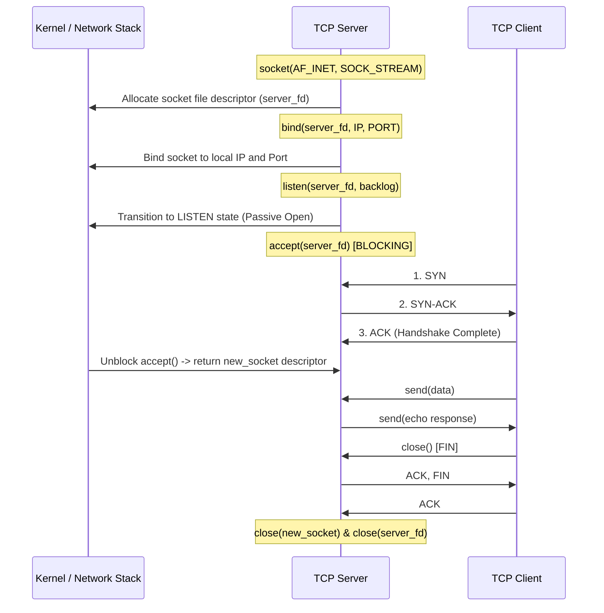

# Experiment 2: Socket Programming for Transport Layer Packets (TCP Server)

---

## 1. Aim
To implement and analyze a connection-oriented Transport Layer Server using TCP Socket Programming in C.

---

## 2. Theory

### What is a Socket?
A network socket is a software abstraction representing an endpoint of a bidirectional inter-process communication flow across an IP network. It is uniquely defined by a 5-tuple association:
$$\text{Association} = \{\text{Protocol}, \text{Source IP}, \text{Source Port}, \text{Destination IP}, \text{Destination Port}\}$$

### TCP at the Transport Layer
TCP (Transmission Control Protocol, RFC 793) operates at Layer 4 of the OSI Reference Model. It provides:
1. **Connection-Oriented Delivery:** Establishes a virtual circuit via the TCP Three-Way Handshake (`SYN` $\rightarrow$ `SYN-ACK` $\rightarrow$ `ACK`) before any data payload is transmitted.
2. **Reliability & Error Recovery:** Guarantees packet arrival using cumulative sequence numbers, ACKs, checksums, and Retransmission Timers (RTO).
3. **Ordered Byte-Stream:** Delivers bytes to the application layer strictly in sequence, reassembling out-of-order packets.
4. **Flow & Congestion Control:** Implements Sliding Window flow control and algorithms like Slow Start, Congestion Avoidance, Fast Retransmit, and Fast Recovery.

### Server-Side Passive Open Sequence



1. **`socket(AF_INET, SOCK_STREAM, 0)`**:
   Allocates an endpoint descriptor in the OS kernel. `AF_INET` specifies the IPv4 address family, and `SOCK_STREAM` specifies byte-stream TCP.
2. **`bind(server_fd, ...)`**:
   Binds the created socket descriptor to a well-known local address and port (`INADDR_ANY` binds across all active network interfaces).
3. **`listen(server_fd, backlog)`**:
   Puts the socket into a passive listening mode and initializes the kernel queues (`SYN` queue and `Accept` queue) with capacity determined by `backlog`.
4. **`accept(server_fd, ...)`**:
   Extracts the first completed connection from the queue, blocking until a client completes the 3-way handshake. Crucially, it creates and returns a **new socket descriptor (`new_socket`)** dedicated exclusively to communication with that specific client, freeing `server_fd` to listen for new incoming connections.
5. **Data Transfer (`read()` / `recv()`, `write()` / `send()`)**:
   Streams data reliably over full-duplex socket buffers.
6. **`close(new_socket)`**:
   Executes the TCP Four-Wave Teardown sequence (`FIN` $\rightarrow$ `ACK` $\rightarrow$ `FIN` $\rightarrow$ `ACK`) releasing kernel socket memory.

---

## 3. Algorithm

1. **Start**
2. Declare variables: socket descriptors `server_fd`, `new_socket`, address structure `sockaddr_in`, buffer array, and address length.
3. Call `socket(AF_INET, SOCK_STREAM, 0)`. If result $< 0$, display error and exit.
4. Set server address structure parameters:
   - `sin_family = AF_INET`
   - `sin_addr.s_addr = INADDR_ANY`
   - `sin_port = htons(PORT)`
5. Invoke `bind()`. If binding fails, display error and terminate.
6. Call `listen(server_fd, 3)` to await client connection requests.
7. Invoke `accept()`. Program blocks until a client connects.
8. While client connection is active:
   - Clear buffer using `memset()`.
   - Read $N$ bytes into buffer via `read()`.
   - If bytes read $\le 0$, break loop (client disconnected).
   - Print received message to terminal.
   - Echo message back to client using `send()`.
9. Close `new_socket` and `server_fd`.
10. **Stop**

---

## 4. Source Files in this Folder

| File Name | Description | Protocol & Port |
| :--- | :--- | :--- |
| `server.c` | Standard TCP Echo Server | TCP (Port `10276` / user-defined) |
| `tcp_calc_server.c` | Arithmetic Addition TCP Server | TCP (Port `10279`) |
| `tcp_student_server.c` | Student Result Calculation Server | TCP (Port `8080`) |

---

## 5. Compilation & Execution Instructions

On Linux / Ubuntu / WSL / macOS:
```bash
# 1. Compile the echo server
gcc -Wall -o server server.c

# 2. Run the server (listen mode)
./server
```

*(Keep the server running in one terminal window while executing the TCP Client from `exp 3` in a second terminal window).*

To compile the additional servers:
```bash
# Arithmetic Server
gcc -Wall -o tcp_calc_server tcp_calc_server.c
./tcp_calc_server

# Student Result Server
gcc -Wall -o tcp_student_server tcp_student_server.c
./tcp_student_server
```

---

## 6. Sample Terminal Output

```text
$ gcc server.c -o server
$ ./server
TCP Echo Server listening on port 10276...
Client connected from 127.0.0.1:54892
Received: Hello Server
Received: Akshan
Received: Hello World!
Client disconnected or EOF reached.
Server terminated gracefully.
```

---

## 7. Observation Table

| Step | Action | Function Called | Expected / Observed Output |
| :---: | :--- | :--- | :--- |
| 1 | Socket creation | `socket(AF_INET, SOCK_STREAM, 0)` | Valid descriptor integer $> 0$ returned |
| 2 | Address binding | `bind(...)` | Returns 0 (Port successfully assigned) |
| 3 | Passive listening | `listen(server_fd, 3)` | Server transitions to passive TCP state |
| 4 | Client acceptance | `accept(...)` | Returns new client descriptor upon handshake |
| 5 | Data reception | `read(...)` | Reads data stream from client buffer |
| 6 | Echo transmission | `send(...)` | Returns echoed byte stream back to client |
| 7 | Termination | `close(...)` | TCP FIN handshake releases socket |

---

## 8. Conclusion
The TCP Server socket was successfully implemented at the Transport Layer using C socket APIs. The full passive open execution pipeline (`socket`, `bind`, `listen`, `accept`) was executed, establishing a reliable, connection-oriented channel capable of processing incoming client data streams.

