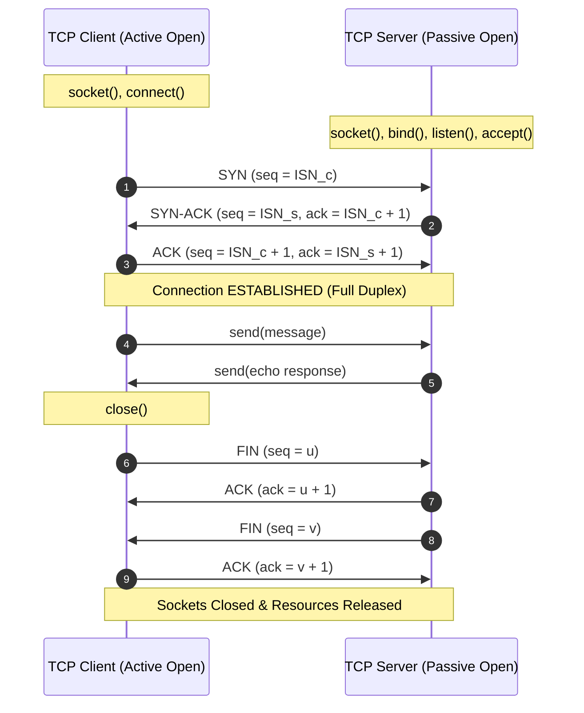

# Experiment 3: Socket Programming for Transport Layer Packets (TCP Client)

---

## 1. Aim
To implement and analyze an active client socket application using TCP socket programming in C.

---

## 2. Theory

### Client-Server Architecture & Active Open
In a client-server network model, the **client** is the active initiator. While the server remains in a passive listening state at a well-known port, the client issues an **Active Open** request directed to the server's specific IP address and port.

### The TCP Three-Way Handshake
When `connect()` is invoked by the client, the kernel network stack executes the Three-Way Handshake with the destination server:
1. **`SYN` (Synchronize):** The client sends a packet with the SYN flag set and an initial sequence number ($ISN_c$) to initiate connection synchronization.
2. **`SYN-ACK`:** The server responds acknowledging the client's ISN ($ACK = ISN_c + 1$) and transmits its own initial sequence number ($ISN_s$).
3. **`ACK`:** The client returns an acknowledgment packet ($ACK = ISN_s + 1$). The socket state transitions to `ESTABLISHED`, allowing reliable stream data exchange.



### Client Execution Steps:
1. **`socket(AF_INET, SOCK_STREAM, 0)`**:
   Allocates an endpoint socket descriptor configured for IPv4 and TCP streaming.
2. **Server Address Setup (`struct sockaddr_in`)**:
   Specifies the target server's IP address (converted from text to binary format via `inet_pton()` or `inet_addr()`) and port number (in network byte order using `htons()`).
3. **`connect(sock, ...)`**:
   Initiates the TCP three-way handshake with the server. Returns `0` on success or `-1` on error.
4. **Data Transmission (`send()` / `write()` and `recv()` / `read()`)**:
   Exchanges user payloads over the full-duplex byte stream.
5. **Connection Termination (`close()`)**:
   Gracefully initiates the four-way FIN teardown sequence.

---

## 3. Algorithm

1. **Start**
2. Declare variables: socket descriptor `sock`, server address structure `sockaddr_in`, buffer array, and strings for messages.
3. Call `socket(AF_INET, SOCK_STREAM, 0)`. Verify valid descriptor is returned.
4. Set server connection parameters:
   - `sin_family = AF_INET`
   - `sin_port = htons(PORT)`
   - Set `sin_addr.s_addr` using `inet_pton(AF_INET, SERVER_IP, &server_addr.sin_addr)` or `inet_addr()`.
5. Call `connect(sock, (struct sockaddr *)&server_addr, sizeof(server_addr))`.
   - If connection fails, display error and exit.
6. Display successful connection prompt.
7. Loop:
   - Read message string from user via `fgets()`.
   - If user input equals `"exit"`, break loop.
   - Send string to server using `send(sock, buffer, strlen(buffer), 0)`.
   - Clear buffer with `memset()`.
   - Read server reply using `read(sock, buffer, sizeof(buffer) - 1)`.
   - Print echoed reply to terminal.
8. Call `close(sock)` to terminate connection.
9. **Stop**

---

## 4. Source Files in this Folder

| File Name | Description | Target Port |
| :--- | :--- | :--- |
| `client.c` | Standard TCP Echo Client | Port `10276` |
| `tcp_calc_client.c` | Arithmetic Addition Client | Port `10279` |
| `tcp_student_client.c` | Student Result Client with RTT Measurement | Port `8080` |

---

## 5. Compilation & Execution Instructions

```bash
# 1. Compile the echo client
gcc -Wall -o client client.c

# 2. Run the client (ensure the server in exp 2 is already running)
./client
```

To compile and run the additional clients:
```bash
# Arithmetic Client
gcc -Wall -o tcp_calc_client tcp_calc_client.c
./tcp_calc_client

# Student Result Client
gcc -Wall -o tcp_student_client tcp_student_client.c
./tcp_student_client
```

---

## 6. Sample Terminal Output

```text
$ gcc client.c -o client
$ ./client
Connecting to TCP Server at 127.0.0.1:10276...
Successfully connected to TCP Server!
Type 'exit' to terminate.

Enter message: Hello Server
Echo from server: Hello Server
Enter message: Akshan
Echo from server: Akshan
Enter message: Hello World!
Echo from server: Hello World!
Enter message: exit
Closing client connection...
```

For `tcp_student_client`:
```text
$ ./tcp_student_client
Connected to TCP Server.

Enter student name: Akshan Motghare
Enter PRN: 24070521276
Enter marks for Subject 1: 85
Enter marks for Subject 2: 90
Enter marks for Subject 3: 88
Enter marks for Subject 4: 92
Enter marks for Subject 5: 95

----- Result -----
Student Name : Akshan Motghare
PRN          : 24070521276
Percentage   : 90.00%
Response Time: 0.285 ms
```

---

## 7. Observation Table

| Step | Action | Function Called | Expected / Observed Output |
| :---: | :--- | :--- | :--- |
| 1 | Socket creation | `socket(AF_INET, SOCK_STREAM, 0)` | Client socket descriptor created successfully |
| 2 | Server connection | `connect(...)` | SYN/ACK handshake completed; connection established |
| 3 | Send payload | `send(...)` | Bytes successfully transmitted to server socket buffer |
| 4 | Receive response | `read(...)` | Echoed payload received without corruption or byte loss |
| 5 | Socket closing | `close(...)` | TCP connection terminated cleanly with FIN exchange |

---

## 8. Conclusion
The TCP Client socket was successfully constructed at the Transport Layer using C socket APIs. Utilizing the active open mechanism (`socket`, setting server parameters, and `connect`), the client successfully established a connection with the server via the TCP Three-Way Handshake and verified reliable, bidirectional, stream-based data transmission.

