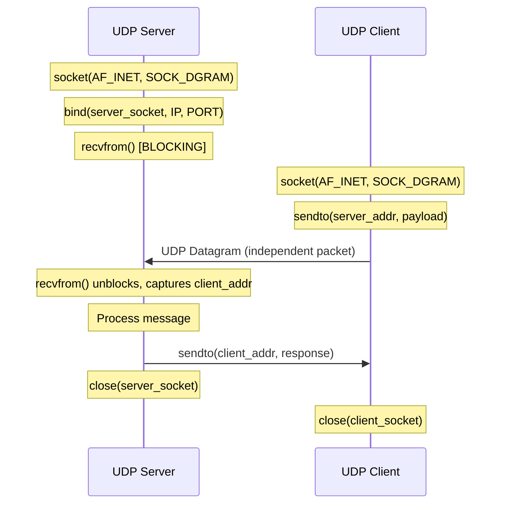

# Experiment 4: Socket Programming for Transport Layer Packets (UDP Server)

---

## 1. Aim
To implement and analyze a connectionless Transport Layer Server using UDP Socket Programming in C.

---

## 2. Theory

### What is UDP?
The **User Datagram Protocol (UDP, RFC 768)** operates at the Transport Layer (Layer 4) of the OSI model. Unlike TCP, UDP is:
1. **Connectionless:** Transmits standalone datagrams without establishing a prior virtual circuit or three-way handshake.
2. **Unreliable (Best-Effort):** Does not provide delivery acknowledgments, retransmissions, packet reordering, or flow control.
3. **Low Latency & Minimal Overhead:** Has a lightweight 8-byte fixed header (Source Port, Destination Port, Length, Checksum) compared to TCP's 20–60 byte header.
4. **Independent Datagram Boundary Preservation:** UDP preserves message boundaries; each `recvfrom()` call reads exactly one datagram sent by `sendto()`.

### UDP Server Architecture

Unlike a TCP server, a UDP server does **not** call `listen()` or `accept()`, nor does it create a separate client socket descriptor. A single UDP socket descriptor handles both receiving datagrams from any client and replying back.



### Server Execution Steps:
1. **Socket Creation (`socket()`):**
   ```c
   server_socket = socket(AF_INET, SOCK_DGRAM, 0);
   ```
   Specifies `SOCK_DGRAM` for datagram service over IPv4 (`AF_INET`).
2. **Address Binding (`bind()`):**
   Associates the datagram socket with a specific local port and IP (`INADDR_ANY`).
3. **Receiving Datagrams (`recvfrom()`):**
   Blocks awaiting incoming packets. The kernel populates the `client_addr` structure with the sender's IP address and ephemeral port.
4. **Sending Responses (`sendto()`):**
   Transmits the reply datagram explicitly targeting the captured `client_addr`.
5. **Closing Socket (`close()`):**
   Releases the UDP socket file descriptor.

---

## 3. Algorithm

1. **Start**
2. Declare variables: `server_socket`, `server_addr`, `client_addr`, buffer, and length variables.
3. Call `socket(AF_INET, SOCK_DGRAM, 0)`. Verify successful allocation ($> 0$).
4. Initialize server address:
   - `sin_family = AF_INET`
   - `sin_addr.s_addr = INADDR_ANY`
   - `sin_port = htons(PORT)`
5. Bind socket descriptor to server address via `bind()`.
6. Display server running status with designated port.
7. Call `recvfrom(server_socket, buffer, sizeof(buffer)-1, 0, (struct sockaddr *)&client_addr, &client_len)`:
   - Program blocks until a datagram arrives.
   - Record sender IP address and port from `client_addr`.
8. Null-terminate and print received message to console.
9. Prepare response string and dispatch via:
   - `sendto(server_socket, response, strlen(response), 0, (struct sockaddr *)&client_addr, client_len)`.
10. Call `close(server_socket)`.
11. **Stop**

---

## 4. Source Files in this Folder

| File Name | Description | Port |
| :--- | :--- | :--- |
| `server_udp.c` | Standard UDP Datagram Server | Port `8080` |
| `udp_student_server.c` | Student Result UDP Server | Port `8081` |

---

## 5. Compilation & Execution Instructions

```bash
# 1. Compile the UDP Server
gcc -Wall -o server_udp server_udp.c

# 2. Run the server
./server_udp
```

*(Keep the server running, then execute the UDP Client in `exp 5` from another terminal).*

To compile the student result UDP server:
```bash
gcc -Wall -o udp_student_server udp_student_server.c
./udp_student_server
```

---

## 6. Sample Terminal Output

```text
$ gcc server_udp.c -o server_udp
$ ./server_udp
UDP Server is running on port 8080...
Received datagram from 127.0.0.1:49214
Message from Client: hello
Response sent back to client.
```

For `udp_student_server`:
```text
$ ./udp_student_server
UDP Server started...
Waiting for client data on port 8081...

Student Details Received:
Name : Akshan Motghare
PRN  : 24070521276
Subject 1 Marks : 85.00
Subject 2 Marks : 90.00
Subject 3 Marks : 88.00
Subject 4 Marks : 92.00
Subject 5 Marks : 95.00
Percentage calculated: 90.00%
Result dispatched to client.
```

---

## 7. Observation Table

| Step | Operation | Function | Observation |
| :---: | :--- | :--- | :--- |
| 1 | Socket creation | `socket(AF_INET, SOCK_DGRAM, 0)` | Datagram socket descriptor initialized |
| 2 | Port binding | `bind(...)` | Successfully bound to port 8080 / 8081 |
| 3 | Await packet | `recvfrom(...)` | Blocks without prior handshake until packet arrives |
| 4 | Capture sender | `client_addr` | Sender IP and port extracted from IP/UDP headers |
| 5 | Dispatch reply | `sendto(...)` | Connectionless packet sent to destination address |

---

## 8. Conclusion
The UDP Server socket was successfully implemented at the Transport Layer. By utilizing `SOCK_DGRAM` with `recvfrom()` and `sendto()`, the server successfully bound to its designated port and processed incoming connectionless datagrams without requiring the overhead of establishing a prior network handshake.

