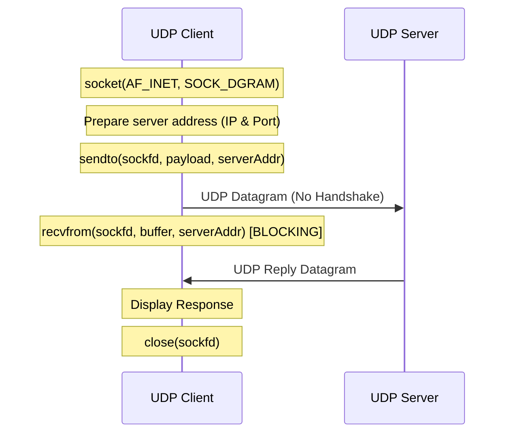

# Experiment 5: Socket Programming for Transport Layer Packets (UDP Client)

---

## 1. Aim
To implement and analyze a connectionless Transport Layer Client using UDP Socket Programming in C.

---

## 2. Theory

### Client Operation in Connectionless Architecture
In the User Datagram Protocol (UDP), the client operates as an independent datagram sender. Unlike TCP:
- No persistent virtual connection is established.
- No `connect()` call is required prior to transmitting data.
- The client encapsulates data into a self-contained datagram with full addressing metadata (destination IP and port) and dispatches it directly onto the network.

### Execution Workflow



### Key Differences Between TCP and UDP Client

| Characteristic | TCP Client (Exp 3) | UDP Client (Exp 5) |
| :--- | :--- | :--- |
| **Protocol Type** | Connection-Oriented | Connectionless |
| **Setup Phase** | Explicit 3-way handshake via `connect()` | None; immediate `sendto()` |
| **Transmission Call** | `send()` or `write()` | `sendto()` specifying destination address |
| **Reception Call** | `recv()` or `read()` | `recvfrom()` capturing sender address |
| **Data Stream** | Continuous byte stream (no boundaries) | Discrete datagram packets (preserves boundaries) |
| **Reliability** | ACKs, checksums, retransmissions | Best-effort (no built-in retries) |
| **Latency / RTT** | Higher initial delay due to handshake | Lower latency, zero setup delay |

---

## 3. Algorithm

1. **Start**
2. Declare variables: socket descriptor `sockfd`, server address structure `serverAddr`, input/output buffers, and address size.
3. Call `socket(AF_INET, SOCK_DGRAM, 0)`. Verify valid descriptor is returned.
4. Configure target server address parameters:
   - `sin_family = AF_INET`
   - `sin_port = htons(PORT)`
   - `sin_addr.s_addr = inet_addr(SERVER_IP)`
5. Read message string from user via `fgets()`.
6. Dispatch message directly using:
   - `sendto(sockfd, message, strlen(message), 0, (struct sockaddr *)&serverAddr, sizeof(serverAddr))`.
7. Wait for response via:
   - `recvfrom(sockfd, buffer, sizeof(buffer)-1, 0, (struct sockaddr *)&serverAddr, &addr_size)`.
8. Null-terminate buffer and display server response on screen.
9. Close socket descriptor via `close(sockfd)`.
10. **Stop**

---

## 4. Source Files in this Folder

| File Name | Description | Port |
| :--- | :--- | :--- |
| `client_udp.c` | Standard UDP Datagram Client | Port `8080` |
| `udp_student_client.c` | Student Result UDP Client with Latency Measurement | Port `8081` |

---

## 5. Compilation & Execution Instructions

```bash
# 1. Compile the UDP Client
gcc -Wall -o client_udp client_udp.c

# 2. Run the client (make sure server_udp in exp 4 is already running)
./client_udp
```

To compile and run the student result UDP client:
```bash
gcc -Wall -o udp_student_client udp_student_client.c
./udp_student_client
```

---

## 6. Sample Terminal Output

```text
$ gcc client_udp.c -o client_udp
$ ./client_udp
Enter message: hello
Server Response: Hello from UDP Server
```

```text
$ ./client_udp
Enter message: Akshan Motghare 276
Server Response: Hello from UDP Server
```

For `udp_student_client`:
```text
$ ./udp_student_client
UDP Client started.

Enter student name: Akshan Motghare
Enter PRN: 24070521276
Enter marks for Subject 1: 85
Enter marks for Subject 2: 90
Enter marks for Subject 3: 88
Enter marks for Subject 4: 92
Enter marks for Subject 5: 95

----- Result -----
Student Name : Akshan Motghare
PRN          : 24070521276
Percentage   : 90.00%
Response Time: 0.142 ms
```

> **Note on Performance:** Notice that UDP round-trip response time (~0.142 ms) is lower than TCP (~0.285 ms) because UDP omits the TCP state machine, sequence synchronization, and acknowledgment packet exchanges.

---

## 7. Observation Table

| Step | Action | API Call | Expected / Observed Output |
| :---: | :--- | :--- | :--- |
| 1 | Socket creation | `socket(AF_INET, SOCK_DGRAM, 0)` | UDP socket descriptor created |
| 2 | Destination setup | `serverAddr` struct | Destination IP and port specified |
| 3 | Transmission | `sendto(...)` | Datagram dispatched immediately without handshaking |
| 4 | Reception | `recvfrom(...)` | Server response datagram received and unpacked |
| 5 | Socket closing | `close(...)` | Local socket descriptor released |

---

## 8. Conclusion
The UDP Client socket was successfully constructed at the Transport Layer using C socket APIs. Using `SOCK_DGRAM` and the `sendto()` system call, the client demonstrated lightweight, connectionless communication by sending datagram packets directly to the destination server without needing to perform a TCP-style connection handshake.

