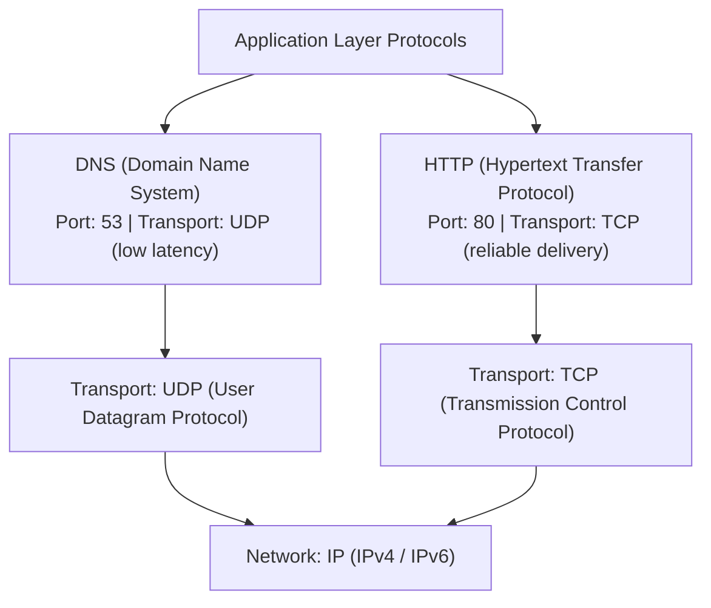

# Experiment 7: Application Layer Packet Analysis using Packet Tracer / Wireshark (DNS & HTTP)

---

## 1. Aim
To analyze Application Layer packets (DNS & HTTP) using a packet analyzer tool (Wireshark) and examine their underlying protocol architecture, headers, and transmission characteristics.

---

## 2. Tools Required
- **Wireshark** (Network Protocol & Packet Analyzer)
- Internet connection / Local Web Server
- Web Browser (Chrome / Edge / Firefox)
- Command Line Tools: `nslookup`, `curl`, `ping`

---

## 3. Theoretical Background

The Application Layer is the top layer (Layer 7) of the OSI model and Layer 4 of the TCP/IP model. It directly interacts with end-user software applications to deliver network services.



### 1. DNS (Domain Name System)
- **Role:** Maps hostnames to IP addresses.
- **Port:** **UDP Port 53**.
- **Query Type:** Client sends a DNS Query containing Transaction ID, Query Name (e.g. `www.google.com`), and Type (`A`).
- **Response Type:** Server returns matching Resource Records (RRs) with TTL, IP address list, and status flags.

### 2. HTTP (Hypertext Transfer Protocol)
- **Role:** Facilitates retrieval of hypermedia documents across the World Wide Web.
- **Port:** **TCP Port 80** (unencrypted plaintext, ideal for Wireshark inspection).
- **Transport Mechanism:** Relies on TCP connection establishment via Three-Way Handshake before sending HTTP methods.
- **HTTP Request:** Client sends request headers:
  - **Method:** `GET`, `POST`, `HEAD`
  - **Request-URI:** `/` or `/connecttest.txt`
  - **Headers:** `Host`, `User-Agent`, `Accept`, `Connection`
- **HTTP Response:** Web server responds with status and content:
  - **Status Code:** `200 OK`, `301 Moved Permanently`, `404 Not Found`
  - **Headers:** `Content-Type: text/html`, `Content-Length`, `Server`, `Date`
  - **Entity Body:** HTML page markup or data payload.

---

## 4. Step-by-Step Procedure

### Part A: DNS Packet Analysis
1. Start Wireshark and select your active network interface (Wi-Fi or Ethernet). Click the shark-fin icon to start capture.
2. Open terminal and run:
   ```cmd
   nslookup www.google.com
   ```
3. In Wireshark, stop capture and type `dns` into the filter bar.
4. Locate the outgoing DNS query packet:
   - Identify **Source Port** (ephemeral, e.g. `53894`), **Destination Port** (`53`), **Protocol** (`UDP`).
   - Expand the DNS payload tree: observe **Transaction ID**, **Flags** (`0x0100`), **Questions** section.
5. Locate the incoming DNS response packet:
   - Confirm identical **Transaction ID**.
   - Inspect **Flags** (`0x8180` Standard query response, No error).
   - Inspect the **Answers** section to verify resolved IP addresses and **TTL** value.

---

### Part B: HTTP Packet Analysis
1. Restart packet capture in Wireshark.
2. Open browser or terminal and access an unencrypted HTTP website (e.g. `http://example.com` or `http://neverssl.com`):
   ```cmd
   curl -I http://example.com
   ```
3. Stop capture and apply filter:
   ```wireshark
   http
   ```
4. Locate and inspect the **HTTP GET Request**:
   - Verify underlying transport is **TCP Port 80**.
   - Inspect HTTP Request headers:
     - `Request Method: GET`
     - `Request URI: /`
     - `Request Version: HTTP/1.1`
     - `Host: example.com`
     - `User-Agent: curl/...` or browser identifier.
5. Locate and inspect the **HTTP Response**:
   - Inspect Response status line: `HTTP/1.1 200 OK`.
   - Inspect headers: `Content-Type: text/html; charset=UTF-8`, `Content-Length`.
   - Inspect the returned HTML data payload under **Line-based text data**.

---

## 5. Comparative Observation Table

| Protocol Characteristic | DNS Query / Response | HTTP Request / Response |
| :--- | :--- | :--- |
| **Transport Protocol** | **UDP** | **TCP** |
| **Default Port Number** | **53** | **80** |
| **Handshake Required** | None (Connectionless) | Yes (TCP 3-Way Handshake SYN, SYN-ACK, ACK) |
| **Method / Query Type** | Standard Query (A Record, MX, AAAA) | Method: `GET`, `POST`, `HEAD` / Status `200 OK` |
| **Identifier / Matching** | 16-bit **Transaction ID** | TCP Sequence & Acknowledgment Numbers |
| **Key Header Fields** | Flags, Questions, Answers, TTL | Host, User-Agent, Content-Type, Content-Length |
| **Target Address Observed**| `www.google.com` $\rightarrow$ IP list | `http://example.com` $\rightarrow$ HTML payload |
| **Data Payload Format** | Compact binary resource records | Plaintext ASCII request / HTML response |

---

## 6. Helper Script
To reproduce traffic automatically:
- Execute `generate_traffic.bat`:
  ```cmd
  .\generate_traffic.bat
  ```

---

## 7. Result
1. DNS queries and responses over UDP port 53 were successfully captured and verified.
2. HTTP GET requests and HTTP 200 OK responses over TCP port 80 were captured, demonstrating header formatting and content parsing in Wireshark.

---

## 8. Conclusion
- DNS prioritizes low latency by using connectionless UDP port 53 with Transaction ID tracking.
- HTTP relies on connection-oriented TCP port 80 to ensure guaranteed, in-order transmission of web resources and documents.
- Wireshark provides end-to-end packet visibility across the transport and application layers of the network stack.

