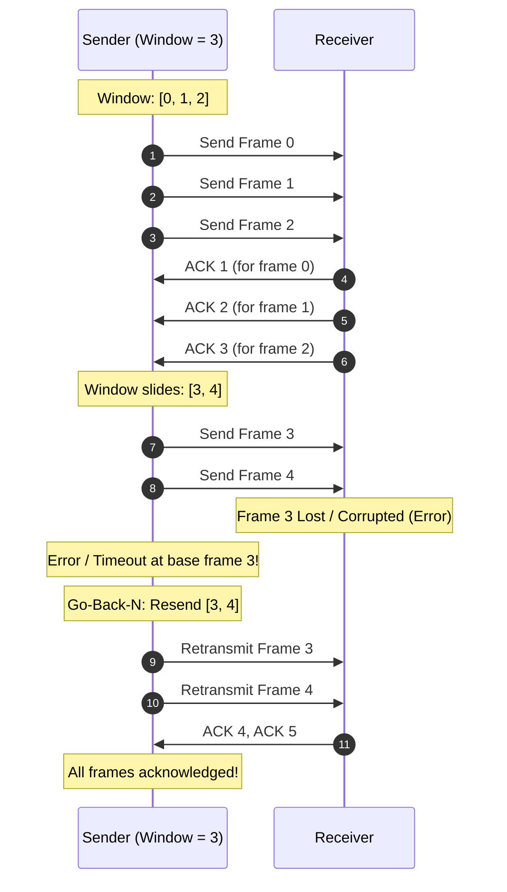

# Experiment 8: Sliding Window Protocol (Go-Back-N ARQ)

---

## 1. Aim
To simulate and analyze the Sliding Window Protocol using the **Go-Back-N Automatic Repeat reQuest (ARQ)** algorithm in C.

---

## 2. Objective
- To understand flow and error control mechanisms in the Data Link Layer and Transport Layer.
- To simulate the Go-Back-N protocol logic using arrays, window pointers, and acknowledgment handling in C.
- To observe how the sender window slides forward upon receiving acknowledgments and how retransmissions are triggered upon channel error or packet loss.

---

## 3. Theoretical Background

### Need for Flow and Error Control
In computer networks, a fast sender can easily overwhelm a slow receiver (buffer overflow), and physical transmission media are prone to bit errors and packet loss.
- **Stop-and-Wait ARQ:** The sender transmits one frame and blocks until an ACK is received. This results in very low channel utilization ($U = \frac{1}{1 + 2a}$), especially in high Bandwidth-Delay Product (BDP) networks.
- **Pipelined Protocols (Sliding Window):** Allows the sender to transmit multiple consecutive frames up to a maximum window size ($W$) without waiting for immediate individual acknowledgments, keeping the transmission pipe full.

### Go-Back-N ARQ Architecture
In **Go-Back-N ARQ**:
- The sender maintains a window of size $W$.
- The sequence numbers of transmitted frames fall within $[base, base + W - 1]$.
- **Cumulative ACKs:** The receiver accepts frames **strictly in order**. If frame $k$ arrives correctly, the receiver increments its expected sequence number and returns an ACK for $k$.
- **Error / Loss Handling:** If an out-of-order frame or corrupted frame arrives, the receiver discards it and all subsequent frames, resending an ACK for the last correctly received in-order frame.
- **Retransmission:** If a timeout occurs for the oldest unacknowledged frame (`base`), the sender **goes back to $N$** (i.e. to `base`) and retransmits **all** frames currently in the window $[base, next\_seq - 1]$.



---

## 4. Algorithm

### Sender Side:
1. Input total number of frames $N$ and sender window size $W$.
2. Initialize `base = 0`.
3. While `base < N`:
   - Compute current active window span: `current_window = min(W, N - base)`.
   - Display active frames inside window: `[base] ... [base + current_window - 1]`.
   - Transmit all frames inside the current window.
   - Simulate receiver acknowledging the frames.
   - Prompt user if frames were received without error (`y`/`n`):
     - If `y` (Correct): Window slides forward: `base = base + current_window`.
     - If `n` (Error / NAK): Do not advance `base`. Trigger Go-Back-N retransmission starting from `frames[base]`.
4. Output success message when `base >= N`.

### Receiver Side:
1. For each incoming frame within the window:
   - Accept frame and generate cumulative acknowledgment (`ACK = frame_number + 1`).

---

## 5. Source Code

The complete implementation is available in [`sliding_window.c`](./sliding_window.c).

### Compilation & Execution:
```bash
# Compile using GCC
gcc -Wall -o sliding_window sliding_window.c

# Run the program
./sliding_window
```

---

## 6. Sample Execution Traces

### Case 1: Normal Transmission (No Errors)
```text
========================================
  Sliding Window Protocol (Go-Back-N)  
========================================
Enter number of frames to send (max 50): 5
Enter window size: 3

Experiment: Sliding Window Protocol
Go-Back-N Protocol Simulation Started

Sender window: [0] [1] [2] 
Sending frames...
Sent frame: 0
Sent frame: 1
Sent frame: 2

Simulating receiver...
Received frame: 0, sending ACK: 1
Received frame: 1, sending ACK: 2
Received frame: 2, sending ACK: 3

Did all frames receive correctly? (y/n): y

Sender window: [3] [4] 
Sending frames...
Sent frame: 3
Sent frame: 4

Simulating receiver...
Received frame: 3, sending ACK: 4
Received frame: 4, sending ACK: 5

Did all frames receive correctly? (y/n): y

All frames sent successfully!
```

### Case 2: Error Simulation with Go-Back-N Retransmission
```text
Sender window: [0] [1] [2] 
Sending frames...
Sent frame: 0
Sent frame: 1
Sent frame: 2

Simulating receiver...
Received frame: 0, sending ACK: 1
Received frame: 1, sending ACK: 2
Received frame: 2, sending ACK: 3

Did all frames receive correctly? (y/n): n
Error detected! Resending from frame 0 (Go-Back-N)...

Sender window: [0] [1] [2] 
Sending frames...
Sent frame: 0
Sent frame: 1
Sent frame: 2
...
```

---

## 7. Observation Table

| Step | Command / Action | Input Parameters | Observation / Result |
| :---: | :--- | :--- | :--- |
| 1 | Program compilation | `gcc -Wall -o sliding_window sliding_window.c` | Compiled cleanly with 0 warnings/errors |
| 2 | Initial transmission | Total Frames = 5, Window = 3 | Window `[0] [1] [2]` transmitted |
| 3 | Receiver simulation | Frames 0, 1, 2 received | ACKs 1, 2, 3 generated |
| 4 | Positive ACK (`y`) | Input `y` | Sender window slid forward to `[3] [4]` |
| 5 | Negative ACK (`n`) | Input `n` | Go-Back-N triggered; retransmitted from base |
| 6 | Completion | All frames acknowledged | Loop terminated; all frames sent successfully |

---

## 8. Conclusion
The Sliding Window Protocol (Go-Back-N ARQ) was successfully simulated and analyzed using C:
1. Pipelining demonstrated efficient link utilization by sending multiple frames up to window capacity before blocking.
2. The sliding behavior was verified as received ACKs shifted the window forward.
3. The Go-Back-N error recovery rule was validated, confirming that unacknowledged or lost frames cause the sender to retransmit from the base sequence number.

