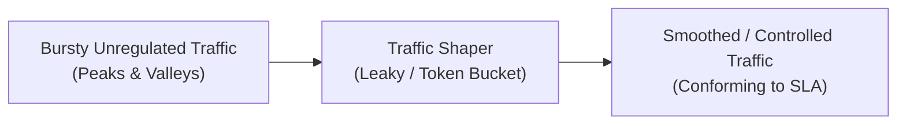

# Experiment 9: Traffic Shaping Algorithms (Leaky Bucket & Token Bucket)

---

## 1. Aim
To simulate and compare traffic shaping and open-loop congestion control mechanisms using the **Leaky Bucket** and **Token Bucket** algorithms in C.

---

## 2. Objective
- To understand the role of traffic shaping in avoiding network congestion and managing bursty transmissions.
- To implement the **Leaky Bucket** algorithm, observing how unregulated, bursty traffic is smoothed into a strictly uniform, fixed output rate.
- To implement the **Token Bucket** algorithm, observing how accumulated tokens allow controlled bursts while capping maximum traffic injection.
- To analyze key trade-offs between Leaky Bucket and Token Bucket algorithms.

---

## 3. Theoretical Background

### Network Congestion & Traffic Shaping
When network arrival rate temporarily exceeds router transmission capacity, buffers fill up and packets drop. Traffic shaping regulates the rate and volume of traffic admitted into the network:



### 1. Leaky Bucket Algorithm
- **Analogy:** Imagine a bucket with a small hole in the bottom. No matter at what rate water is poured into the bucket, water leaks out through the hole at a constant rate until the bucket is empty. If water is poured in faster than the bucket capacity, the excess spills over (packets dropped).
- **Behavior:**
  - **Input:** Any bursty rate.
  - **Output:** Rigidly **constant rate** ($R$).
  - **Drawback:** Cannot transmit faster even during periods of network idle time or sudden urgent bursts.

### 2. Token Bucket Algorithm
- **Analogy:** Tokens are generated by a clock at a constant rate ($R$) and deposited into a token bucket of finite capacity ($B$). Packets may only be transmitted if an equivalent number of tokens are available.
- **Behavior:**
  - When no packets are transmitted, tokens accumulate up to capacity $B$.
  - When a burst of packets arrives, it can consume all accumulated tokens immediately, transmitting a **burst** at maximum wire speed.
  - After tokens are exhausted, transmission throttles to the steady-state token generation rate.
  - If tokens arrive when the bucket is full, excess tokens are discarded (packets are not dropped unless tokens are insufficient at sending time).

### Comparison: Leaky Bucket vs. Token Bucket

| Feature | Leaky Bucket | Token Bucket |
| :--- | :--- | :--- |
| **Output Rate** | Strictly constant, rigid | Variable; permits controlled bursts |
| **Burst Handling** | Discards/buffers bursts; cannot transmit faster | Allows bursts up to bucket capacity ($B$) |
| **Bucket Contents** | Packets awaiting transmission | Tokens awaiting packet arrival |
| **Packet Dropping** | When packet buffer overflows ($> B$) | When packets arrive and tokens are depleted |
| **Primary Use** | ATM networks, strict rate policing | Modern IP Quality of Service (QoS), DiffServ |

---

## 4. Algorithms

### Part A: Leaky Bucket Algorithm
1. **Input:** Bucket capacity $B$, outgoing rate $R$, time units $N$, incoming packets per time unit $P[i]$.
2. Initialize `stored = 0`.
3. For each time unit $i = 1$ to $N$:
   - Read incoming packets $P[i]$.
   - If `stored + P[i] > B`:
     - Discard overflow: `dropped = stored + P[i] - B`.
     - `stored = B`.
   - Else: `stored = stored + P[i]`.
   - If `stored <= R`:
     - `sent = stored`, `stored = 0`.
   - Else:
     - `sent = R`, `stored = stored - R`.
   - Display packets sent, dropped, and remaining in bucket.
4. While `stored > 0` (drain remaining packets):
   - Transmit $\min(stored, R)$ packets per step until `stored = 0`.
5. **End**.

### Part B: Token Bucket Algorithm
1. **Input:** Bucket capacity $B$, token generation rate $R$, time units $N$, packets to send $P[i]$.
2. Initialize `tokens = 0`.
3. For each time unit $i = 1$ to $N$:
   - Add new tokens: `tokens = min(tokens + R, B)`.
   - Read packets to send $P[i]$.
   - If `tokens >= P[i]`:
     - Send all $P[i]$ packets: `tokens = tokens - P[i]`.
   - Else:
     - Send `tokens` packets; discard `dropped = P[i] - tokens`.
     - `tokens = 0`.
   - Display packets sent, dropped, and tokens remaining.
4. **End**.

---

## 5. Source Files in this Folder

| File Name | Description | Output Characteristic |
| :--- | :--- | :--- |
| `leaky_bucket.c` | Leaky Bucket Traffic Shaper | Fixed constant outflow rate |
| `token_bucket.c` | Token Bucket Traffic Shaper | Burst-tolerant token-based transmission |

---

## 6. Compilation & Execution Instructions

```bash
# 1. Leaky Bucket Simulation
gcc -Wall -o leaky_bucket leaky_bucket.c
./leaky_bucket

# 2. Token Bucket Simulation
gcc -Wall -o token_bucket token_bucket.c
./token_bucket
```

---

## 7. Sample Terminal Outputs

### Leaky Bucket Test Run
```text
=========================================
     Leaky Bucket Algorithm Simulation   
=========================================
Enter bucket size (capacity): 10
Enter outgoing rate (leak rate): 3
Enter number of time units: 3

Time unit 1:
Enter number of incoming packets: 4
Packets sent: 3
Packets remaining in bucket: 1

Time unit 2:
Enter number of incoming packets: 3
Packets sent: 3
Packets remaining in bucket: 1

Time unit 3:
Enter number of incoming packets: 1
Packets sent: 2
Packets remaining in bucket: 0

Simulation complete.
```

### Token Bucket Test Run
```text
=========================================
     Token Bucket Algorithm Simulation   
=========================================
Enter bucket size (maximum token capacity): 10
Enter token generation rate (tokens/time unit): 4
Enter number of time units: 3

Time unit 1:
Enter number of packets to send: 3
Packets sent: 3
Tokens left: 1

Time unit 2:
Enter number of packets to send: 3
Packets sent: 3
Tokens left: 2

Time unit 3:
Enter number of packets to send: 9
Only 6 tokens available, packets sent: 6, packets dropped: 3
Tokens left: 0

Simulation complete.
```

---

## 8. Observation Tables

### Table 1: Leaky Bucket Observations ($B = 10, R = 3$)
| Time Unit | Incoming Packets | Stored Before Leak | Packets Sent | Remaining in Bucket | Dropped Packets |
| :---: | :---: | :---: | :---: | :---: | :---: |
| 1 | 4 | 4 | 3 | 1 | 0 |
| 2 | 3 | 4 | 3 | 1 | 0 |
| 3 | 1 | 2 | 2 | 0 | 0 |

### Table 2: Token Bucket Observations ($B = 10, R = 4$)
| Time Unit | Tokens Accumulated | Packets Requested | Packets Sent | Packets Dropped | Tokens Remaining |
| :---: | :---: | :---: | :---: | :---: | :---: |
| 1 | 4 | 3 | 3 | 0 | 1 |
| 2 | $1 + 4 = 5$ | 3 | 3 | 0 | 2 |
| 3 | $2 + 4 = 6$ | 9 | 6 | 3 | 0 |

---

## 9. Conclusion
1. The **Leaky Bucket** algorithm successfully enforced a deterministic, fixed outflow rate, eliminating traffic bursts at the expense of potential packet queuing and discarding when buffer capacity is exceeded.
2. The **Token Bucket** algorithm demonstrated greater flexibility by accumulating transmission credits (tokens) during idle intervals, thereby allowing controlled bursts to pass without packet loss as long as tokens are available.

